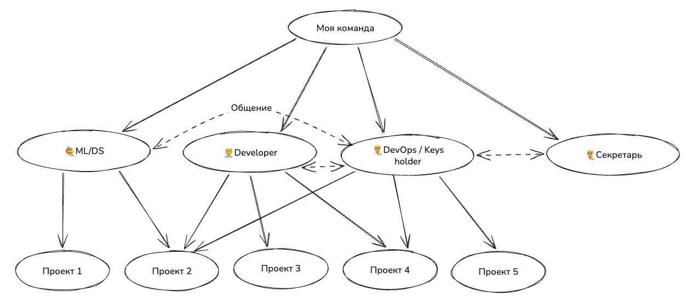

# agents_crew

Команда ИИ-сотрудников, где **сотрудник — это каталог, а не промпт**. Каждый живёт в
своей папке со своими правилами, памятью и журналом, запускается любым консольным
харнессом (`claude`, `codex`, `free-code`, `deepagents`, `kimi`) и работает в любом из
твоих проектов.

Это обезличенный пример рабочей схемы: шаблон и три готовых персонажа, у каждого свой
набор проектов. Проекты настоящие — публичные репозитории, чтобы по заметкам было видно,
что писать в память и на каком уровне подробностей.

> **Обновление, ноябрь 2026.** Свежая редакция шаблона персонажа лежит в
> [`kross-character/`](kross-character/): на старте читается короткая карта памяти,
> правила пользователя отделены от выводов агента, память ищется по теме, а ссылки и
> индексы проверяет скрипт. Чем она отличается от августовской — в
> [её README](kross-character/README.md#отличия-от-августовского-шаблона). Всё остальное
> в репозитории — августовская версия: команда из трёх персонажей и `crew_template/`.



Сверху команда, посередине роли, снизу проекты. Каждый сотрудник ходит в свои
несколько, поэтому память получается общая внутри специальности, а не внутри
репозитория.

## Зачем

Есть два привычных способа работать с ассистентом, и оба перекошены.

**Треды с общей памятью** (chatgpt и подобные). Ассистент помнит тебя, но одинаково
помнит всё: спрашиваешь про бекенд — получаешь контекст из позапрошлого проекта.

**Один проект — одна директория** (claude code, codex cli). Агент точно знает
репозиторий, в котором сидит, и ничего не знает за его пределами. Открыл соседний
проект — и снова объясняешь, кто ты и как тут принято.

Персонаж стоит посередине. Память привязана к **специальности**, а не к треду и не к
репозиторию: ML-сотрудник помнит все свои эксперименты во всех проектах сразу,
бекендер — свои интеграции, и контексты не смешиваются. Плюс персонажи знают друг о
друге и могут спросить совета, запустив харнесс в каталоге соседа.

Скоупы при этом **частично пересекаются**: `anima_sdk` и `ERC3_AI_Agent` есть и у Лоры,
и у Стива, но заметки о них разные — она держит дизайн эксперимента, он рантайм и
стоимость прогона. Кто с чем работает, целиком — в [`CREW.md`](CREW.md#кто-с-какими-проектами-работает).

Почему именно персонажи с именами: с сущностями наш мозг работает лучше, чем с
конфигами. «Спроси Лору» короче и точнее, чем «подгрузи профиль ML-специалиста».

## Что внутри

```
AGENTS.md          правила команды, запуск, процедура найма
CREW.md            кто есть в команде и кого о чём просить
crew_template/     шаблон нового сотрудника
kross-character/   свежий шаблон персонажа, редакция ноября 2026
crew_lora/         пример: ML / Data Science
crew_steve/        пример: Python / бекенд
crew_alfred/       пример: доступы, ключи, заявки
```

Каждый сотрудник устроен одинаково:

```
crew_<имя>/
├── AGENTS.md              правила и специализация — единственный источник правды
├── CLAUDE.md -> AGENTS.md симлинк для харнессов со своим именем файла
├── memory/
│   ├── MEMORY.md          индекс, читается в начале каждого запуска
│   ├── projects/          один файл на проект
│   ├── lessons.md         обратная связь создателя и выводы из провалов
│   └── stack.md           окружение, доступы, стенды
└── journal/               YYYY-MM.md, хронология работы
```

Отсюда три свойства: **переносимость** (сотрудник не привязан к харнессу, всё
состояние — обычный markdown), **версионируемость** (личность и память в git, видно
как менялись правила) и **изоляция** (у каждого своя память, общего хранилища нет
намеренно).

Первое из них — главное, поэтому у схемы есть название: **мета-харнесс**. Харнесс тут
расходник, вчера один, завтра другой, а сотрудник переезжает на новое место обычным
`git clone` со всем, что успел узнать.

Главное ограничение того же происхождения: между запусками переносится только то, что
записано в файлы. Из контекста сессии не выживает ничего.

## Быстрый старт

```sh
git clone https://github.com/Rai220/agents_crew && cd agents_crew
```

1. **Подставь пути.** В файлах стоят плейсхолдеры `{{CREW_ROOT}}` (корень этого
   репозитория) и `{{PROJECTS_ROOT}}` (где лежат твои рабочие проекты). Пути должны
   быть абсолютными: харнессы стартуют из разных каталогов.

   ```sh
   CREW=$(pwd); PROJECTS=$HOME/projects     # поправь под себя
   grep -rl '{{CREW_ROOT}}\|{{PROJECTS_ROOT}}' --include='*.md' . \
     | xargs sed -i '' -e "s|{{CREW_ROOT}}|$CREW|g" -e "s|{{PROJECTS_ROOT}}|$PROJECTS|g"
   ```

2. **Запусти сотрудника** из его дома:

   ```sh
   cd crew_lora && claude        # или codex / free-code / deepagents / kimi
   ```

   Харнесс сам подхватит `AGENTS.md` или `CLAUDE.md`. Если твой не подхватывает
   ничего — скажи первым сообщением: `Прочитай ./AGENTS.md и ./memory/MEMORY.md,
   дальше действуй по ним`.

3. **Замени проекты на свои** — заметки в `crew_*/memory/` написаны по чужим
   репозиториям и нужны только как образец формата.

## Что нужно заполнить

Из коробки это скелет: он запустится, но пользы даст мало, пока в нём нет твоей
специфики. По убыванию важности.

- **`memory/projects/` — проекты, с которыми сотрудник работает.** Самое главное и
  единственное, чего нельзя пропустить. **Заметки в примерах написаны по чужим
  репозиториям — их надо снести и завести свои.** Рабочий размер скоупа — 3-10 проектов
  на сотрудника. Один файл на проект: путь, зачем он, как запускать, какие грабли, что
  уже пробовали и не взлетело, о чём договорились.
  Ссылку на файл добавь в `memory/MEMORY.md` — он читается в начале каждого запуска,
  остальное подтягивается по ссылкам. У Альфреда единица знания не проект, а система
  с доступом, поэтому у него `memory/access/`.
- **Раздел 4 «Регламент по специальности» в `AGENTS.md`.** Главная ценность
  сотрудника. В примерах он заполнен — перечитай и поправь под свои процессы. Пиши
  правилами, а не пожеланиями: что проверять до начала, какие ошибки типовые, что
  нельзя делать без подтверждения, как отчитываться.
- **Раздел 1 «Кто ты».** Специализация конкретно, чтобы было понятно, какие задачи
  его, а какие соседа. В примерах помечены места, куда дописать доменную специфику.
- **`memory/stack.md`.** Окружение, железо, менеджер зависимостей, стенды. Отдельно —
  договорённость про секреты: что сотруднику можно читать, а что нет. Без явной
  строчки агент будет решать это каждый раз заново.
- **Раздел «Работа с другими сотрудниками» в `AGENTS.md` каждого.** Список соседей и
  их специальностей. Если новичка не дописать остальным, они о нём не узнают и за
  консультацией не придут. Там же стоит назвать общие проекты и кто в них за что
  отвечает — иначе двое начнут править одно и то же с разными целями.

Полная процедура найма нового сотрудника — в [`AGENTS.md`](AGENTS.md#4-как-нанять-нового).

## Как этим пользуются

- **Один сотрудник — одна специальность.** Задача не по профилю выполняется хуже и
  засоряет память нерелевантным.
- **Обратная связь дороже задачи.** Поправка «так не делай, потому что…» попадает в
  `memory/lessons.md` и работает во всех следующих запусках. Молча переделанная за
  сотрудника работа не учит никого.
- **В конце запуска — попроси записать память.** Хороший запуск, из которого ничего не
  записано, повторится с нуля.
- **Консультация у соседа** — это просто запуск его харнесса, никакого протокола:

  ```sh
  cd ../crew_alfred && claude -p "Привет, Альфред, это Лора, подскажи какие у нас ключи к openai"
  ```

  Глубина ровно один шаг: вызванный отвечает и говорит, к кому идти дальше, но сам
  третьего не зовёт — иначе цена запуска непредсказуема.

## Чего здесь нет

Это выжимка из личной рабочей команды, поэтому вырезано:

- настоящая память и журналы — они разглашают ровно то, чем занимаешься. Заметки по
  проектам собраны заново, по публичным репозиториям, и служат образцом формата;
- личность сверх роли: у сотрудников остались имя, абзац про тон и регламент по
  специальности. Больше персонажу и не нужно — биография и лор не меняют ответы, а
  контекст занимают;
- любой GUI. Сотрудник — это каталог, разговор с ним ведёт харнесс, и никакого
  приложения для этого не требуется. Своё поверх написать можно, но к схеме оно
  отношения не имеет;
- отдельные git-репозитории на каждого сотрудника: здесь они лежат папками в одном
  репо, так удобнее смотреть целиком. В работе лучше по репозиторию на сотрудника —
  память быстро набирает то, что не хочется отдавать вместе со схемой.
